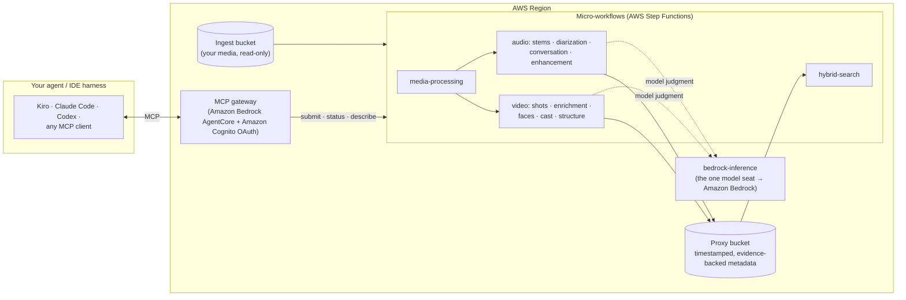

# Unified Media Toolkit

Unified Media Toolkit gives AI agents the ability to understand media
natively. Video and audio are opaque to a language model; this toolkit
turns them into structured, timestamped, evidence-backed metadata that
agents can reason over, query, and act on — making the media archive
itself part of the agentic workflow.

The toolkit is a progressive iteration of the open-source
[Media2Cloud](https://github.com/aws-solutions-library-samples/guidance-for-media2cloud-on-aws)
guidance, rebuilt for the agent era: where Media2Cloud ran a static,
pre-wired analysis workflow, the Unified Media Toolkit is conversational
and dynamic — AI agents and coding harnesses compose the workflows at
run time, deciding per asset what to analyze, in what order, and how
deep to go. Everything is serverless and pay-per-run — zero idle cost,
with per-run cost accounting built into every workflow's outputs (see
[What it costs](#what-it-costs)).

**There is no web user interface.** The toolkit exposes an MCP server
(Amazon Bedrock AgentCore Gateway) that connects directly to your agent
or IDE harness — [Kiro](https://kiro.dev/) (AWS's agentic IDE, built
around spec-driven development with autonomous agents), Claude Code,
Codex, or anything that speaks MCP.
See [Connect your agent](#connect-your-agent).

> **Looking for an end-to-end experience?** Use the open-source
> [Media Harness](https://github.com/aws-samples/sample-media-agent-harness-on-aws),
> purpose-built for media. Its CDK package bundles these same Unified
> Media Toolkit binaries — install the Media Harness and you can skip
> this repository entirely.

## Choose your path

| You want… | Deploy |
|---|---|
| An end-to-end media agent experience, batteries included | [Media Harness](https://github.com/aws-samples/sample-media-agent-harness-on-aws) — it bundles this toolkit; **skip this repo** |
| Media capabilities as MCP tools inside your own harness ([Kiro](https://kiro.dev/), Claude Code, Codex, custom agents) | **This repo** — the [one-stack bundle](#deploy-step-by-step) below |
| A single capability (e.g. just diarization) embedded in your own pipeline | That workflow's folder — each is an independently deployable stack (see the table) |

## Architecture



An agent connects once to the gateway and sees every workflow as a
three-tool MCP contract (submit / status / describe); it composes the
pipeline conversationally and every output lands in the proxy bucket as
timestamped, evidence-backed JSON.

Each capability is an independently deployable, serverless AWS Step
Functions micro-workflow with a uniform contract:

| workflow | what it does |
|---|---|
| [media-processing-on-aws](media-processing-on-aws/) | transcode, probe, frame extraction |
| [audiostem-separation-on-aws](audiostem-separation-on-aws/) | music / speech / effects stem separation |
| [speech-enhancement-on-aws](speech-enhancement-on-aws/) | in-place dialogue noise suppression |
| [speech-diarization-on-aws](speech-diarization-on-aws/) | who-spoke-when + transcription |
| [conversation-analysis-on-aws](conversation-analysis-on-aws/) | topic segments + spoken-evidence facts |
| [shot-segmentation-on-aws](shot-segmentation-on-aws/) | shot lattice, frame archives, stability stats |
| [shot-metadata-enrichment-on-aws](shot-metadata-enrichment-on-aws/) | VLM semantic layer per shot |
| [face-recognition-on-aws](face-recognition-on-aws/) | face tracks, celebrity/collection identity |
| [cast-resolution-on-aws](cast-resolution-on-aws/) | binds anonymous speakers, face tracks, and on-screen text into named persons |
| [program-structure-analysis-on-aws](program-structure-analysis-on-aws/) | programme markers: slates, credits, recaps |
| [frame-inspection-on-aws](frame-inspection-on-aws/) | internal witness: credits/title frame reads |
| [artwork-selection-on-aws](artwork-selection-on-aws/) | ranked, diverse artwork/thumbnail slates |
| [audio-description-on-aws](audio-description-on-aws/) | described-video narration, synthesized and fitted |
| [tts-on-aws](tts-on-aws/) | text-to-speech voices and synthesis |
| [hybrid-search-on-aws](hybrid-search-on-aws/) | lexical + vector search over the metadata |
| [bedrock-inference-on-aws](bedrock-inference-on-aws/) | the ONE model seat: batched/sync Bedrock inference with callbacks |
| [prompt-registry-on-aws](prompt-registry-on-aws/) | versioned, immutable prompt templates |
| [media-toolkit-gateway](media-toolkit-gateway/) | the MCP gateway: every workflow as an agent tool |
| [micro-workflow-bundle](micro-workflow-bundle/) | the one-stack deployment bundling the family |

Workflows compose by consuming each other's Amazon Simple Storage Service (Amazon S3) outputs — deploy only
what you need. Every workflow is exposed to agents through an MCP
gateway with a standard three-tool contract (submit / status /
describe), so an agent can orchestrate the full pipeline
conversationally: analyze an asset, resolve who appears in it, pick
its artwork, generate its described-video track — without bespoke
integration per capability. Long-running work parks on callback
tokens rather than polling; idempotent run identity means a retried
request absorbs into the existing run instead of paying twice.

The design patterns underneath: the **dynamism lives at the
orchestration layer** — agents compose workflows freely — while
**inside each workflow we build and handle the deterministic mechanics,
encapsulating the complexity**: plain code owns the time alignment,
joins, and ranking, and Amazon Bedrock models are reserved for the
narrow judgments only a model can make (describing a shot, naming a
topic) — so results are repeatable and testable, and tokens are never
spent on arithmetic.
Alongside it: evidence-over-verdict outputs (every claim carries its
mechanism, timespan, and confidence), cross-run ledgers that never
re-pay for evidence already obtained, and per-run cost accounting.

## Deploy, step by step

**Prerequisites**

1. An AWS account with permissions to create AWS CloudFormation
   stacks, AWS Identity and Access Management (IAM) roles, AWS Lambda
   functions, Step Functions state machines, Amazon Elastic Container
   Registry (Amazon ECR) repositories, AWS CodeBuild projects, Amazon
   Cognito resources, and Amazon Bedrock AgentCore resources.
2. An **existing Amazon S3 bucket with your source media** (the `IngestBucket`
   parameter — the stack never writes to it).
3. **Amazon Bedrock model access enabled** in your chosen region for the
   models the AI-backed workflows call (Anthropic Claude and Amazon Nova
   families at minimum) — enable them in the Bedrock console before
   deploying, or those workflows fail at run time, not deploy time.
4. Pick a region from the [Releases](#releases) table — artifacts are
   staged per region and each template references its own region's
   bucket, so deploy in the template's region.

**Deploy**

5. Launch the stack — either the **one-click URL** from the Releases
   table, or the CLI:

```bash
aws cloudformation create-stack \
  --stack-name unified-media-toolkit \
  --template-url <TemplateURL for your region, Releases table below> \
  --parameters ParameterKey=IngestBucket,ParameterValue=MY_INGEST_BUCKET \
  --capabilities CAPABILITY_IAM CAPABILITY_NAMED_IAM \
  --region <region>
```

6. Wait. A first create takes **1–2 hours**: the container-based
   workflows each build their image in CodeBuild inside their nested
   stack, in parallel. It is not hung.

**After the stack completes**

7. Read the stack **Outputs** — they carry everything an operator
   needs: the MCP `GatewayUrl`, the credentials secret (name + ARN),
   the proxy bucket, the effective `ResourcePrefix`, and
   `IngestBucketReadRoleArns`.
8. [Connect your agent](#connect-your-agent) — credentials, token, and
   ready-made harness configuration.
9. **Cross-account ingest bucket only (otherwise skip)**: the stack's
   workflow roles already carry IAM read permission on the ingest
   bucket, so a same-account bucket works with no further setup. If the
   ingest bucket lives in a **different account** — or enforces its own
   allow-list bucket policy — have the bucket owner add the
   `IngestBucketReadRoleArns` principals to the bucket policy
   (read-only).

On stack **updates**, re-read the Outputs: IAM role ARNs are
CloudFormation-generated, so a role replacement changes
`IngestBucketReadRoleArns` / `GatewayCredentialsSecretArn`, and bucket
policies consuming them must be refreshed.

## Input parameters

| Parameter | Default | Required | Description |
|---|---|---|---|
| `IngestBucket` | — | **yes** | Existing S3 bucket holding source media. Read-only to the workflows. Deliberately has no default: it holds media the stack cannot recreate, so a typo must fail loudly at deploy, not silently at runtime. |
| `ProxyBucket` | `""` | no | Bucket for all workflow outputs (under `micro-workflow/`). **Leave blank** to have the stack create and own one named `{Prefix}-{stack-id}-{account}-{region}-proxy` (retained on delete); supply a name only to reuse an existing bucket, e.g. one retained from a deleted bundle. |
| `Prefix` | `umt` | no | Leading part of the resource-name prefix for the workflow children; a 12-char stack-id slice is appended automatically. Lowercase letters/digits/hyphens, **max 14 chars** (the limit is arithmetic — it lands in S3 bucket names). |
| `GatewayName` | `""` | no | AgentCore Gateway name. **Leave blank** to derive `{Prefix}-{stack-id}` automatically — unique per bundle, so default-parameter bundles never collide. Set it to pin a stable gateway identity: the credentials secret path follows it, so a pinned name survives a stack re-creation with zero client reconfiguration. A pinned `GatewayName`+`Environment` pair must be unique per **account** (the Cognito domain it seeds is a global namespace). |
| `Environment` | `dev` | no | `dev` \| `staging` \| `prod`. Part of the credentials secret path `/{GatewayName}/{Environment}/gateway-credentials`. |
| `OAuthScope` | `media-workflows` | no | Cognito resource-server identifier; the full OAuth scope is `<OAuthScope>/invoke`. |
| `SecretsKmsKeyId` | `alias/aws/secretsmanager` | no | AWS Key Management Service (AWS KMS) key (id, ARN, or alias) encrypting the gateway credentials secret. |

After deploy, the stack Outputs carry everything an operator needs: the MCP
`GatewayUrl`, the credentials secret (name + ARN), the proxy bucket name and
ownership flag, the effective `ResourcePrefix`, and
`IngestBucketReadRoleArns` (the read-only principals for the ingest bucket
owner's bucket policy).

## What it costs

Everything is serverless: nothing runs (or bills) between jobs, and every
workflow writes a per-run `usage_tracking.json` breaking its bill into
compute and model spend. Measured examples from real runs (us-east-1-class
pricing; your content and parameters will vary):

| workflow | ~12-min short film | ~45-min TV episode |
|---|---|---|
| media-processing (proxy + audio) | $0.01 | $0.05 |
| audiostem-separation | $0.13 | $0.54 |
| speech-diarization (+ transcript) | $0.03 | $0.14 |
| shot-segmentation | $0.05 | $0.23 |
| face-recognition (collection + celebrity) | $0.06 | $0.34 |
| conversation-analysis (batch) | $0.01 | ~$0.05 |
| shot-metadata-enrichment (batch, with faces) | $0.28 | $1.10–2.20 |
| **full analysis, end to end** | **≈ $0.60** | **≈ $2.50–3.50** |

The AI-backed workflows (enrichment, conversation analysis) default to
Bedrock **batch** inference at half the on-demand token price; the
deterministic workflows are pure compute. Indexing an analyzed episode
into hybrid-search adds cents, and searches cost fractions of a cent.

## Releases

Template URL pattern:
`https://{bucket}.s3.{region}.amazonaws.com/unified-media-toolkit/{version}/micro-workflow-bundle/micro-workflow-bundle-stack.template`
(us-east-1 uses the regionless `s3.amazonaws.com` domain.)

### v0.1.0 — 2026-10-21

First semantically versioned release (see CHANGELOG.md). Headlines:
audiostem-separation ships the opt-in `speech_safe` output
(`audio_speech_safe.wav` — attenuated mix patched into
separator-deleted spans, crossfaded) with the `speech_stem_gaps`
activity lane; speech-diarization accuracy work lands (VAD defaults at
the measured WER knee, word-to-sentence partition with seam-twin dedup,
config-level ASR hygiene knobs — pooled 19-episode caption battery
11.70% → 11.08% WER); compare-models skill (N-model CA/SME comparison
page); open-source posture (CODE_OF_CONDUCT, CONTRIBUTING, MIT-0
License/Security sections) and the Bandit v2 weights license record
(CC BY-SA 4.0).

| Region | URLs |
|---|---|
| eu-west-1 | Template URL:<br>https://awsi-megs-guidances-eu-west-1.s3.eu-west-1.amazonaws.com/unified-media-toolkit/v0.1.0/micro-workflow-bundle/micro-workflow-bundle-stack.template<br><br>One-click URL:<br>https://console.aws.amazon.com/cloudformation/home?region=eu-west-1#/stacks/quickcreate?templateURL=https://awsi-megs-guidances-eu-west-1.s3.eu-west-1.amazonaws.com/unified-media-toolkit/v0.1.0/micro-workflow-bundle/micro-workflow-bundle-stack.template&stackName=unified-media-toolkit<br><br>Client kit package URL:<br>https://awsi-megs-guidances-eu-west-1.s3.eu-west-1.amazonaws.com/unified-media-toolkit/v0.1.0/client-kit-v0.1.0.zip |
| us-east-1 | Template URL:<br>https://awsi-megs-guidances-us-east-1.s3.amazonaws.com/unified-media-toolkit/v0.1.0/micro-workflow-bundle/micro-workflow-bundle-stack.template<br><br>One-click URL:<br>https://console.aws.amazon.com/cloudformation/home?region=us-east-1#/stacks/quickcreate?templateURL=https://awsi-megs-guidances-us-east-1.s3.amazonaws.com/unified-media-toolkit/v0.1.0/micro-workflow-bundle/micro-workflow-bundle-stack.template&stackName=unified-media-toolkit<br><br>Client kit package URL:<br>https://awsi-megs-guidances-us-east-1.s3.amazonaws.com/unified-media-toolkit/v0.1.0/client-kit-v0.1.0.zip |
| us-west-2 | Template URL:<br>https://awsi-megs-guidances-us-west-2.s3.us-west-2.amazonaws.com/unified-media-toolkit/v0.1.0/micro-workflow-bundle/micro-workflow-bundle-stack.template<br><br>One-click URL:<br>https://console.aws.amazon.com/cloudformation/home?region=us-west-2#/stacks/quickcreate?templateURL=https://awsi-megs-guidances-us-west-2.s3.us-west-2.amazonaws.com/unified-media-toolkit/v0.1.0/micro-workflow-bundle/micro-workflow-bundle-stack.template&stackName=unified-media-toolkit<br><br>Client kit package URL:<br>https://awsi-megs-guidances-us-west-2.s3.us-west-2.amazonaws.com/unified-media-toolkit/v0.1.0/client-kit-v0.1.0.zip |
| ap-southeast-2 | Template URL:<br>https://awsi-megs-guidances-ap-southeast-2.s3.ap-southeast-2.amazonaws.com/unified-media-toolkit/v0.1.0/micro-workflow-bundle/micro-workflow-bundle-stack.template<br><br>One-click URL:<br>https://console.aws.amazon.com/cloudformation/home?region=ap-southeast-2#/stacks/quickcreate?templateURL=https://awsi-megs-guidances-ap-southeast-2.s3.ap-southeast-2.amazonaws.com/unified-media-toolkit/v0.1.0/micro-workflow-bundle/micro-workflow-bundle-stack.template&stackName=unified-media-toolkit<br><br>Client kit package URL:<br>https://awsi-megs-guidances-ap-southeast-2.s3.ap-southeast-2.amazonaws.com/unified-media-toolkit/v0.1.0/client-kit-v0.1.0.zip |
| ap-northeast-1 | Template URL:<br>https://awsi-megs-guidances-ap-northeast-1.s3.ap-northeast-1.amazonaws.com/unified-media-toolkit/v0.1.0/micro-workflow-bundle/micro-workflow-bundle-stack.template<br><br>One-click URL:<br>https://console.aws.amazon.com/cloudformation/home?region=ap-northeast-1#/stacks/quickcreate?templateURL=https://awsi-megs-guidances-ap-northeast-1.s3.ap-northeast-1.amazonaws.com/unified-media-toolkit/v0.1.0/micro-workflow-bundle/micro-workflow-bundle-stack.template&stackName=unified-media-toolkit<br><br>Client kit package URL:<br>https://awsi-megs-guidances-ap-northeast-1.s3.ap-northeast-1.amazonaws.com/unified-media-toolkit/v0.1.0/client-kit-v0.1.0.zip |

Earlier pre-release history (`alpha.*`) is summarized in
[CHANGELOG.md](CHANGELOG.md).

## Connect your agent

After deploy, follow the [Consumer Guide](media-toolkit-gateway/README.md)
— credentials, token, and ready-made config for Claude Code, Codex CLI,
and Kiro, plus the shipped skills. The same guide is published to the
deployment's proxy bucket as part of the client kit
(`_toolkit/client-kit.zip`), beside the configure/token scripts it
describes.

## Repository layout

One folder per workflow, each a self-contained deployable (its own
CloudFormation stack, build script, tests, and design records —
start at any workflow's `README.md`). Deployment of the
whole family is [micro-workflow-bundle](micro-workflow-bundle/).

## Building and testing

Every workflow follows the same conventions:

```bash
cd <workflow>                                   # any workflow folder
python3 -m unittest discover -s test -p 'test_*.py'
bash build-deploy-s3-dist.sh --build-only       # tests + gates + packages
```

To build everything from the top — every workflow, the gateway, the
one-stack bundle template, and the single source package (the tracked
tree, zipped) — run the root build script with the same options:

```bash
bash ./build-deploy-s3-dist.sh --build-only     # local only, no AWS calls
bash ./build-deploy-s3-dist.sh --bucket MY_BUCKET_BASENAME   # build + stage
```

The source package lands in `dist/unified-media-toolkit-sourcecode-<version>.zip`
and, on the staging path, at the release's version root in S3 — the
script closes by printing the template URL, the one-click deploy URL,
and the source package URL.

## Security

See [CONTRIBUTING](CONTRIBUTING.md#security-issue-notifications) for more information.

## License

This library is licensed under the MIT-0 License. See the [LICENSE](LICENSE) file.
